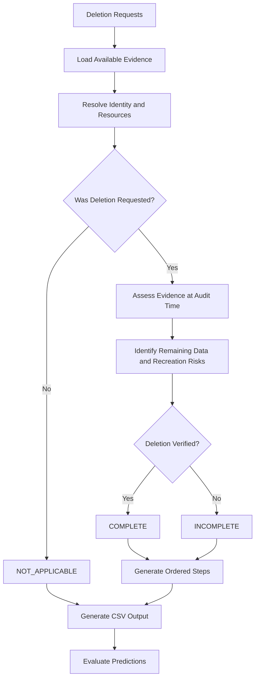

# Ghost Data Deletion Audit

**An evidence-driven Python solution for verifying personal-data deletion requests.**

[](https://www.python.org/)
[](#project-status)
[](#challenge-context)

A deletion workflow can report **Complete** while personal data remains in databases, replicas, logs, support attachments, exports, search indexes, archives, or backups. Synchronization and restoration processes can also recreate data that was previously deleted.

Ghost Data Deletion Audit analyzes available evidence to assess whether a deletion request has actually been completed, identify remaining-data and recreation risks, and generate ordered remediation and verification steps.

> Developed for the HackerRank Orchestrate — October 2026 challenge, **Ghost Data Still Exists**.

## Table of Contents

- [The Problem](#the-problem)
- [Project Objectives](#project-objectives)
- [Key Features](#key-features)
- [Architecture and Workflow](#architecture-and-workflow)
- [Technology Stack](#technology-stack)
- [Repository Structure](#repository-structure)
- [Getting Started](#getting-started)
- [Output Format](#output-format)
- [Evaluation Results](#evaluation-results)
- [Limitations and Future Improvements](#limitations-and-future-improvements)
- [Responsible Data Handling](#responsible-data-handling)
- [Project Status](#project-status)

## The Problem

Deleting a user's personal data is more complicated than changing a record's status to `Deleted`.

Data may persist in secondary systems, historical logs, replicas, exports, attachments, or backup systems. A restoration or synchronization process may also reintroduce previously deleted records.

An effective deletion audit must distinguish between a workflow's reported status and the actual state supported by evidence.

This project addresses three central questions:

1. Was deletion actually requested and authorized?
2. Does the available evidence establish that the relevant data has been deleted, or does it reveal remaining data or recreation risks?
3. What remediation and verification steps are needed to complete the deletion safely?

## Project Objectives

- Assess deletion requests using the evidence available for each case.
- Distinguish requests requiring deletion from those that do not apply.
- Evaluate current and historical identity relationships.
- Identify remaining resources and potential data-recreation risks.
- Generate ordered findings, remediation actions, and verification checks.
- Evaluate predictions against reference answers using automated evaluation tooling.

## Key Features

### Evidence-driven deletion assessment

The solution evaluates available evidence rather than treating a reported workflow status as definitive proof of deletion.

### Identity and resource analysis

Current and historical identity information helps associate requests with the relevant users and resources.

### Remediation planning

The output can represent findings, corrective actions, and verification checks as an ordered sequence.

### Structured predictions

The solution generates CSV output with a deletion classification and JSON-encoded steps for each request.

### Evaluation and testing

The repository includes an evaluation script and reports documenting measured performance, custom test cases, identified failures, and improvements.

## Architecture and Workflow



The diagram describes the intended audit workflow. Actual conclusions depend on the evidence available to the implementation.

## Technology Stack

| Technology | Purpose |
|---|---|
| Python | Core implementation and evaluation tooling |
| CSV | Structured request and prediction data |
| JSON | Ordered step sequences in the output |
| Automated evaluation | Comparison of predictions with reference answers |
| Git and GitHub | Version control and project publication |

## Repository Structure

```text
ghost-data-deletion-audit/
├── README.md
├── .gitignore
└── code/
    ├── README.md
    ├── main.py
    └── evaluation/
        ├── main.py
        ├── evaluation_report.md
        └── usage_report.md
```

- `code/main.py` — main audit implementation.
- `code/README.md` — implementation-specific instructions.
- `code/evaluation/main.py` — evaluation entry point.
- `code/evaluation/evaluation_report.md` — evaluation metrics, test cases, failures, and improvements.
- `code/evaluation/usage_report.md` — documented model usage and cost information.

## Getting Started

### Prerequisites

- Python installed on your system.
- The input files required by the original challenge.
- Any additional dependencies specified in `code/README.md`.

### Run the solution

From the repository root, the original challenge entry point is:

```bash
python code/main.py
```

**Important:** This portfolio repository intentionally excludes the original challenge datasets and evidence files. Running the program requires access to the appropriate authorized input files in the expected layout.

Consult `code/README.md` before execution for implementation-specific setup details.

## Output Format

The original challenge specifies a root-level `output.csv` with the following columns in this exact order:

```csv
case_id,deletion_status,steps_json
```

The supported status values are:

| Status | Meaning |
|---|---|
| `COMPLETE` | Available evidence supports completed deletion. |
| `INCOMPLETE` | Deletion remains outstanding, or the available evidence does not establish completion. |
| `NOT_APPLICABLE` | The request does not require deletion under the challenge contract. |

The `steps_json` field contains an ordered JSON array of findings, remediation actions, and verification checks. The challenge contract specifies an empty array for `NOT_APPLICABLE`.

These definitions describe the challenge's expected output contract, not a guarantee that every generated prediction is correct.

## Evaluation Results

The following figures were recorded during the challenge work.

### Sample evaluation

| Metric | Result |
|---|---:|
| Deletion-status accuracy | 32/32 — 100% |
| Exact step-sequence accuracy | 13/32 — 40.62% |
| Positional step precision | 66.85% |
| Positional step recall | 61.66% |

### Challenge leaderboard

| Metric | Result |
|---|---:|
| Overall score | 46.6/100 |
| Leaderboard rank at the time of the screenshot | #238 |

**How to interpret these results:** The 100% deletion-status accuracy applies to the 32-case sample evaluation only. It does not imply 100% overall challenge accuracy. The lower exact step-sequence score indicates that reproducing the expected remediation and verification sequences was a significant area for improvement.

For the complete recorded evaluation details, custom test cases, failures, and improvements, see `code/evaluation/evaluation_report.md`.

For the documented model usage and cost breakdown, see `code/evaluation/usage_report.md`.

## Limitations and Future Improvements

Potential areas for further development include:

- Improve exact step-sequence matching and operation ordering.
- Expand regression tests for historical identity changes and ambiguous evidence.
- Strengthen evidence coverage across replicas, logs, exports, archives, and restoration processes.
- Improve detection of synchronization and backup-related recreation risks.
- Add reproducible test fixtures and clearer diagnostics for incorrect predictions.
- Introduce stronger authorization controls and integration-specific verification before any production use.

These are improvement areas, not claims that the capabilities have already been implemented.

## Responsible Data Handling

Deletion audits can involve sensitive personal information. The solution should only be used with data that the operator is authorized to access and process.

This public portfolio repository excludes the original challenge datasets, evidence files, private chat logs, and agent-trace archives. Do not commit credentials, API keys, private data, or restricted challenge materials.

Any production implementation would require appropriate access controls, audit logging, retention policies, and safeguards around remediation actions.

## Project Status

This repository presents a portfolio version of a completed programming challenge submission.

The implementation and evaluation reports are provided for review. The recorded leaderboard result and sample metrics are disclosed above, and further validation would be required before treating the solution as production-ready.

## Challenge Context

**HackerRank Orchestrate — October 2026**

**Challenge:** Ghost Data Still Exists

The challenge asks participants to build an agent that assesses whether personal-data deletion was actually completed, reports remaining-data or recreation risks, and produces ordered remediation and verification steps.

